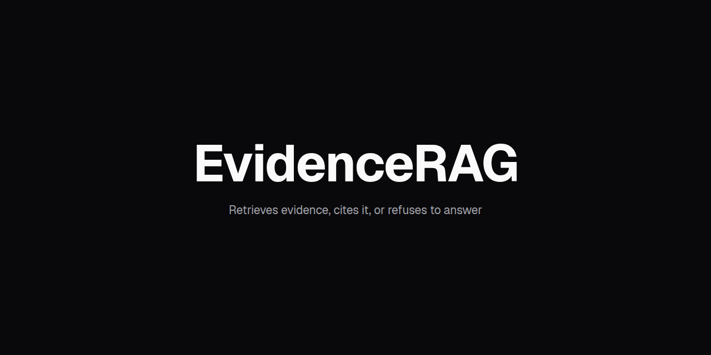

<div align="center">



# EvidenceRAG

### Structure-Aware Hybrid RAG for Technical Document Intelligence

An explainable document question-answering system that parses technical documents into a hierarchical structure, retrieves evidence with a hybrid BM25 + dense pipeline, and refuses to fabricate an answer when the evidence doesn't support one.

<br>

[](https://www.python.org/)
[](https://fastapi.tiangolo.com/)
[](https://nextjs.org/)
[](#how-it-works)
[](./docs/ARCHITECTURE.md)

**[Try the live demo →](https://evidence-rag.vercel.app)** — preloaded with the sample docs below, no setup required.

</div>

---

## Table of Contents

- [Overview](#overview)
- [What Makes EvidenceRAG Different](#what-makes-evidencerag-different)
- [How It Works](#how-it-works)
- [Evaluation Results](#evaluation-results)
- [Technology Stack](#technology-stack)
- [Project Structure](#project-structure)
- [Quick Start](#quick-start)
- [Roadmap & Production Hardening](#roadmap--production-hardening)
- [Current Limitations](#current-limitations)

---

## Overview

EvidenceRAG is a document intelligence system built for technical, industrial, and engineering documents — the kind where a sentence taken out of context ("apply after 600 hours") is worse than no answer at all.

It answers questions using content from Markdown, PDF, Word, Excel, and CSV files. Documents aren't treated as a bag of unrelated text fragments: every parser produces a hierarchical `KnowledgeNode` tree (headings, paragraphs, tables, figures, warnings, notes, code blocks), and that tree is the source of truth for retrieval, not a flat chunk list.

---

## What Makes EvidenceRAG Different

| Typical Tutorial RAG | EvidenceRAG |
|:--|:--|
| Fixed-size flat chunks | Hierarchical `KnowledgeNode` tree |
| Dense retrieval only | BM25 + dense retrieval + RRF |
| Raw Top-K, trusted blindly | Reranking + relevance grading + dedup |
| Matched excerpt in isolation | Full parent-section reconstruction |
| Tables treated as plain text | Tables and figures preserved atomically |
| Hidden retrieval process | Explainability matrix and telemetry |
| Answer with no way to verify it | Numbered source citations (doc, page/section, snippet) |
| Always answers, even on a weak match | Abstains below a configurable retrieval-confidence threshold |

**Design principles:** chunking is a *view* over the document tree, never the primary representation; retrieval gets at most one bounded follow-up hop, triggered by a score threshold rather than another LLM call — adaptive without being an open-ended agent loop; on insufficient evidence or generation failure, the system returns an explicit failure state and the retrieved references, never a fabricated answer.

---

## How It Works

Query rewriting → hybrid BM25 + dense retrieval fused by RRF → reranking → relevance grading →
parent-section reconstruction → a **confidence gate** (abstains rather than guessing on weak
evidence) → grounded generation → a **faithfulness hard gate** (withholds the answer rather than
returning an unsupported one). Every document belongs to its uploader; every chat happens inside a
conversation scoped to 1–5 documents, never a global search box; auth is Supabase JWTs verified
against its public JWKS endpoint, no shared secret.

**Full design doc:** [`docs/ARCHITECTURE.md`](./docs/ARCHITECTURE.md) (pipeline stages, the
swappable-storage/fixed-pipeline split, the LLM-call architecture, observability, the authz layer).
**Every route's contract:** [`docs/API.md`](./docs/API.md).

---

## Evaluation Results

The retrieval pipeline is evaluated against a naive dense-retrieval baseline on a labeled dataset (`docs/eval/eval_set.json`), Top-5 setting, source-file-level ground truth:

| Pipeline | Precision@5 | Recall@5 | MRR |
|:--|--:|--:|--:|
| Naive dense retrieval | 0.857 | 0.857 | 0.857 |
| **Advanced pipeline** | **0.893** (+4.2%) | **1.000** (+16.7%) | **0.905** (+5.6%) |

Every query is also scored for **answer faithfulness**: a second, cheap LLM call acts as a judge given the generated answer and its cited chunks, returning a 0–1 support score plus any unsupported claims (`src/evaluation/judge.py`) — this catches the case retrieval metrics can't: the right document was found, but the answer still misstated what it says. Below `FAITHFULNESS_GATE_THRESHOLD` (0.7), the generated answer is withheld entirely rather than returned as-is — faithfulness is a hard gate, not just a reported score.

Full detail: [`docs/eval/eval_report.md`](./docs/eval/eval_report.md).

### System Numbers

Concrete, source-checked figures rather than vague claims — each one points at where it's enforced or was measured:

| Metric | Value | Where |
|:--|--:|:--|
| Automated tests passing | **299 / 299** | `server/tests/` (`pytest`) |
| Retrieval confidence gate | 0.5 | `RETRIEVAL_CONFIDENCE_THRESHOLD`, `config.py` |
| Faithfulness hard gate | 0.7 | `FAITHFULNESS_GATE_THRESHOLD`, `config.py` |
| Max retrieval hops | 2 (initial + 1 bounded follow-up) | `MAX_HOPS`, `query_pipeline.py` |
| Chunk size / overlap | 200 / 40 tokens | `chunk_size_tokens` / `chunk_overlap_tokens`, `config.py` |
| Embedding dimensions | 1024 | `voyage-3.5`, `VOYAGE_EMBEDDING_DIMENSION` |
| Embedding concurrency speedup | ~4.6x (6 workers vs. sequential) | `EMBED_CONCURRENCY`, `ingestion/pipeline.py` |
| Scoped vs. full-corpus retrieval latency | ~2–5ms flat (5–10k+ chunks) vs. ~250ms at 10k chunks | `retrieval/hybrid.py`, [#27](../../issues/27) |
| pgvector HNSW ANN query latency | ~5ms at 15k rows (Supabase mode) | `idx_chunks_embedding`, [#17](../../issues/17) |
| Response cache | 0.97 cosine similarity match, 3600s TTL, 200 entries/scope cap | `response_cache.py` |
| Rate limits | 20 chat msgs / 5 uploads per 60s per user | `rate_limiter.py` |
| Conversation document cap | 5 documents per conversation | `ConversationCreate` schema |
| Upload size cap | 50MB per file | `document_service.py` |

---

## Technology Stack

| Layer | Technology |
|:--|:--|
| Backend | Python, FastAPI, Uvicorn |
| Frontend | Next.js (App Router), Tailwind CSS, shadcn/ui |
| Auth | Supabase Auth, JWT verified backend-side via JWKS |
| Chat generation | Any OpenAI-compatible endpoint (`LLM_BASE_URL`/`LLM_MODEL`) — currently Gemini's own OpenAI-compatible API |
| Embeddings | Voyage AI (`voyage-3.5`, independent of the chat provider) |
| Retrieval | `rank-bm25` + dense similarity, Reciprocal Rank Fusion |
| Reranking / judging / titling | Same configured LLM endpoint as chat generation, one batched call each |
| Parsing | pdfplumber (PDF), python-docx (DOCX), pandas (XLSX/CSV) |
| Graph visualization | Vis Network |
| Evaluation | Precision@K, Recall@K, MRR, LLM-as-judge faithfulness |

---

## Project Structure

```
├── server/        FastAPI backend - api/ (routers, services, authz), src/ (pipeline, retrieval,
│                   ingestion, storage, core), tests/, scripts/
├── web/            Next.js frontend (app/, components/, hooks/, stores/, lib/)
└── docs/           ARCHITECTURE.md, API.md, fixtures/ (demo corpus), eval/ (eval harness I/O)
```

See [`docs/ARCHITECTURE.md`](./docs/ARCHITECTURE.md) for what's inside `server/src/`.

---

## Quick Start

A Supabase project is required regardless of `STORAGE_MODE` — Auth is always Supabase (no local/mock auth path). Every data route (`/documents`, `/conversations`, `/upload`, `/graph`) requires a signed-in user.

### Server

```bash
cd server
python -m venv .venv && source .venv/bin/activate   # Windows: .venv\Scripts\activate
pip install -r requirements.txt
cp .env.example .env
```

```env
STORAGE_MODE=local                     # or "supabase" for Postgres+pgvector + Supabase Storage
VOYAGE_API_KEY=your-key-here           # embeddings
LLM_BASE_URL=your-openai-compatible-endpoint  # every active LLM call: final answer, query rewriting,
LLM_API_KEY=your-key-here                     #   reranking, faithfulness judging, conversation titling
LLM_MODEL=your-model-id                       #   (Cloudflare Workers AI, Gemini's own OpenAI-compatible
                                               #   endpoint, a self-hosted server, OpenRouter, etc.)
GEMINI_API_KEY=unused-placeholder      # dormant unless ENABLE_ENTITY_GRAPH=true - any non-empty
                                        #   string works, never sent to Google while it's off
ENABLE_ENTITY_GRAPH=false
SUPABASE_URL=https://your-project.supabase.co
CORS_ALLOWED_ORIGINS=http://localhost:3000
```

If `STORAGE_MODE=supabase`, also set `SUPABASE_DB_URL` (use the **connection pooler** string, port 6543 — the direct host is IPv6-only on many projects) and `SUPABASE_KEY`, and run `scripts/supabase_schema.sql` once in the Supabase SQL editor.

```bash
python scripts/ingest.py        # indexes docs/fixtures/sample_docs/ as shared documents
uvicorn api.app:app --reload    # http://127.0.0.1:8000/docs for interactive API docs
```

### Web

```bash
cd web
pnpm install
cp .env.example .env
```

```env
NEXT_PUBLIC_API_URL=http://127.0.0.1:8000
NEXT_PUBLIC_SUPABASE_URL=https://your-project.supabase.co
NEXT_PUBLIC_SUPABASE_ANON_KEY=your-anon-key
```

```bash
pnpm dev
```

Open `http://localhost:3000`, sign up, then start a conversation from the sidebar.

---

## Roadmap & Production Hardening

A ground-up hardening pass across 5 GitHub milestones (security/authz, faithfulness as a hard gate, a real test suite, model routing/guardrails, ops hardening) is complete — see the [System Numbers](#system-numbers) table above for what that bought. Follow-up review rounds have surfaced further gaps since, all filed and closed. See [milestones](../../milestones) and [issues](../../issues) for current status.

---

## Current Limitations

- The retrieval-confidence abstention gate only applies in advanced mode; naive mode always attempts an answer.
- Query rewriting, reranking, generation, and faithfulness judging all go through the same configured LLM endpoint/model — faithfulness isn't judged by an independent model.
- The entity graph is exploration-only, not a retrieval signal, and costs one LLM call per section.
- Every data route requires a signed-in Supabase user; there's no anonymous/read-only demo mode.
