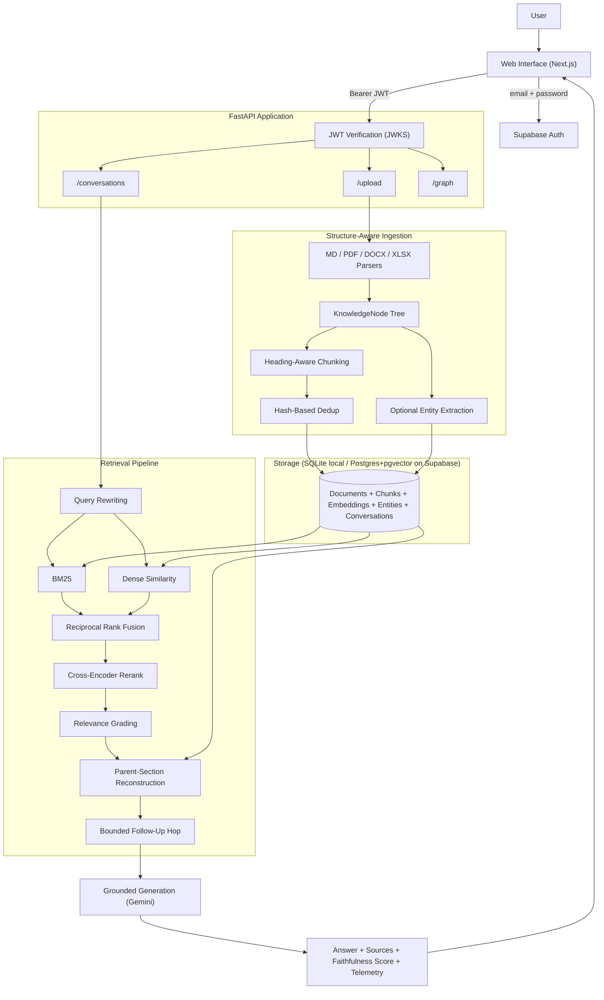

<div align="center">

# EvidenceRAG

### Structure-Aware Hybrid RAG for Technical Document Intelligence

An explainable document question-answering system that parses technical documents into a hierarchical structure, retrieves evidence with a hybrid BM25 + dense pipeline, and refuses to fabricate an answer when the evidence doesn't support one.

<br>

[](https://www.python.org/)
[](https://fastapi.tiangolo.com/)
[](https://nextjs.org/)
[](#how-it-works)
[](#authentication--conversations)

**[Try the live demo →](https://evidence-rag.vercel.app)** — preloaded with the sample docs below, no setup required.

</div>

---

## Table of Contents

- [Overview](#overview)
- [What Makes EvidenceRAG Different](#what-makes-evidencerag-different)
- [How It Works](#how-it-works)
- [Authentication & Conversations](#authentication--conversations)
- [Explainability & Observability](#explainability--observability)
- [Entity Graph](#entity-graph)
- [Evaluation Results](#evaluation-results)
- [Technology Stack](#technology-stack)
- [Project Structure](#project-structure)
- [Quick Start](#quick-start)
- [Roadmap & Production Hardening](#roadmap--production-hardening)
- [Current Limitations](#current-limitations)

---

## Overview

EvidenceRAG is a document intelligence system built for technical, industrial, and engineering documents — the kind where a sentence taken out of context ("apply after 600 hours") is worse than no answer at all.

It answers questions using content from Markdown, PDF, Word, Excel, and CSV files. Documents aren't treated as a bag of unrelated text fragments: every parser produces a hierarchical `KnowledgeNode` tree (headings, paragraphs, tables, figures, warnings, notes, code blocks), and that tree is the source of truth for retrieval, not a flat chunk list.

---

## What Makes EvidenceRAG Different

| Typical Tutorial RAG | EvidenceRAG |
|:--|:--|
| Fixed-size flat chunks | Hierarchical `KnowledgeNode` tree |
| Dense retrieval only | BM25 + dense retrieval + RRF |
| Raw Top-K results | Cross-encoder reranking |
| Always trusts retrieved chunks | Relevance grading and deduplication |
| Matched excerpt in isolation | Full parent-section reconstruction |
| Single retrieval pass | One bounded follow-up retrieval hop |
| Tables treated as plain text | Tables and figures preserved atomically |
| Re-embeds everything | Hash-based incremental ingestion |
| Hidden retrieval process | Explainability matrix and telemetry |
| No relationship layer | Entity co-occurrence graph |
| Answer with no way to verify it | Numbered source citations (doc, page/section, snippet) |
| Always answers, even on a weak match | Abstains below a configurable retrieval-confidence threshold |

**Design principles:** chunking is a *view* over the document tree, never the primary representation; the follow-up retrieval hop is capped at one round, triggered by a score threshold rather than another LLM call — adaptive without being an open-ended agent loop; on insufficient evidence or generation failure, the system returns an explicit failure state and the retrieved references, never a fabricated answer.

---

## How It Works



**Ingestion** — each format-specific parser (Markdown/PDF/DOCX/XLSX) produces the same `KnowledgeNode` shape, so retrieval logic never depends on file format. A document hash check skips re-embedding unchanged files; `ENABLE_ENTITY_GRAPH` optionally extracts per-section entities.

**Query flow** — query rewriting (original + up to 2 rewritten tracks) → hybrid BM25 + dense retrieval fused by RRF → cross-encoder reranking → relevance grading → context compression + full parent-section reconstruction → an adaptive context budget (2/4/5 blocks based on top score) → a **confidence gate**: below `RETRIEVAL_CONFIDENCE_THRESHOLD` the pipeline abstains and returns only the closest-match chunks as `sources`, with no synthesized claim → if confident but a gap remains, one bounded additional retrieval hop (never an open-ended loop) → grounded generation → answer faithfulness scoring (a second, cheap Gemini call checks the answer against its own cited chunks — advisory today, not yet a hard gate; see [Roadmap](#roadmap--production-hardening)). This confidence gate only runs in "advanced mode"; naive mode skips the cross-encoder and always attempts an answer.

Implementation: `server/src/query_pipeline.py` (`process_chat_query`), `server/src/retrieval/*`, `server/src/evaluation/judge.py`.

---

## Authentication & Conversations

Every document belongs to the user who uploaded it, and every chat happens inside a **conversation** scoped to exactly one document — not a global search box.

Sign-in/sign-up talk directly from the browser to Supabase Auth (`web/lib/auth.ts`), never proxied through the backend. The backend's only auth responsibility is verifying a caller's JWT against Supabase's public **JWKS** endpoint (`server/api/deps.py`) — no shared secret stored server-side. Every route requires a valid `Authorization: Bearer <jwt>` except `/health` and `/source/{filename}` (opened via plain browser navigation for citation links).

`documents.user_id` is nullable: `NULL` means a shared/demo document (the `docs/sample_docs/` corpus, indexed via `scripts/ingest.py`), visible to every signed-in user; uploads via `POST /upload` are private to the uploader.

> Per-user ownership is enforced on conversations, but not yet on every document/graph route — tracked in the [Roadmap](#roadmap--production-hardening) below.

---

## Explainability & Observability

Every answer (including an abstention) returns a numbered `sources` array — the exact chunks used to build the prompt, each with document name, page/section, and a short snippet — rendered in the UI as an expandable citation list. A separate `chunks_matrix` field exposes the full retrieval debug trail (BM25/dense/rerank scores, which query track found it, which retrieval hop) for anyone who wants to see *why* a chunk was selected, not just that it was.

Alongside this, a telemetry layer (`telemetry.py`) records stage-level latency and outcome for every query — expansion, embedding, retrieval, reranking, grading, compression, generation, faithfulness scoring — so bottlenecks are found by looking at numbers, not by guessing.

---

## Entity Graph

Each document section can be run through local entity extraction to build a co-occurrence graph (gated by `ENABLE_ENTITY_GRAPH` — one LLM call per section, so it can get expensive on large documents). It currently supports document exploration, concept discovery, and section-level relationship inspection via an interactive visualization (`/graph` in the web UI) — **it is not currently used as a retrieval signal.**

---

## Evaluation Results

The retrieval pipeline is evaluated against a naive dense-retrieval baseline on a labeled dataset (`docs/eval_set.json`), Top-5 setting, source-file-level ground truth:

| Pipeline | Precision@5 | Recall@5 | MRR |
|:--|--:|--:|--:|
| Naive dense retrieval | 0.857 | 0.857 | 0.857 |
| **Advanced pipeline** | **0.893** (+4.2%) | **1.000** (+16.7%) | **0.905** (+5.6%) |

Every query is also scored for **answer faithfulness**: a second, cheap Gemini call acts as an LLM-as-judge given the generated answer and its cited chunks, returning a 0–1 support score plus any unsupported claims (`src/evaluation/judge.py`) — this catches the case retrieval metrics can't: the right document was found, but the answer still misstated what it says.

Full detail: [`docs/eval_report.md`](./docs/eval_report.md).

---

## Technology Stack

| Layer | Technology |
|:--|:--|
| Backend | Python, FastAPI, Uvicorn |
| Frontend | Next.js (App Router), Tailwind CSS, shadcn/ui |
| Auth | Supabase Auth, JWT verified backend-side via JWKS |
| Chat / Embeddings | Gemini (`gemini-2.5-flash` / `gemini-embedding-001`) |
| Retrieval | `rank-bm25` + dense similarity, Reciprocal Rank Fusion |
| Reranking | `bge-reranker-base` (local cross-encoder) |
| Parsing | pdfplumber (PDF), python-docx (DOCX), pandas (XLSX/CSV) |
| Graph visualization | Vis Network |
| Evaluation | Precision@K, Recall@K, MRR, LLM-as-judge faithfulness |

---

## Project Structure

```
├── server/
│   ├── api/            FastAPI app, routers (health, documents, conversations, graph), JWT deps
│   ├── src/
│   │   ├── config.py, llm.py, query_pipeline.py, graph.py (entity extraction), telemetry.py
│   │   ├── storage/     database.py (SQLite / Postgres+pgvector), files.py (disk / Supabase Storage)
│   │   ├── ingestion/   pipeline.py, chunking.py, parsers/ (tree-aware, per format)
│   │   ├── retrieval/   hybrid.py, reranker.py, grader.py, query_rewriter.py, compression.py
│   │   └── evaluation/  judge.py (faithfulness scoring)
│   └── scripts/        ingest.py, run_eval.py, compare_eval.py, supabase_schema.sql
├── web/                 Next.js frontend (app/, components/, hooks/, stores/, lib/)
└── docs/                sample_docs/ (demo corpus) + eval_set.json / eval_report.md / eval_baseline.json
```

A production-grade restructuring (a `services/` layer, split schemas, a real `tests/` tree, `docs/` split into `fixtures/` + `eval/`) is approved and tracked in the [Roadmap](#roadmap--production-hardening) below, but not yet applied to this layout.

---

## Quick Start

A Supabase project is required regardless of `STORAGE_MODE` — Auth is always Supabase (no local/mock auth path). Every data route (`/documents`, `/conversations`, `/upload`, `/graph`) requires a signed-in user.

### Server

```bash
cd server
python -m venv .venv && source .venv/bin/activate   # Windows: .venv\Scripts\activate
pip install -r requirements.txt
cp .env.example .env
```

```env
STORAGE_MODE=local             # or "supabase" for Postgres+pgvector + Supabase Storage
GEMINI_API_KEY=your-key-here
ENABLE_ENTITY_GRAPH=false
SUPABASE_URL=https://your-project.supabase.co
CORS_ALLOWED_ORIGINS=http://localhost:3000
```

If `STORAGE_MODE=supabase`, also set `SUPABASE_DB_URL` (use the **connection pooler** string, port 6543 — the direct host is IPv6-only on many projects) and `SUPABASE_KEY`, and run `scripts/supabase_schema.sql` once in the Supabase SQL editor.

```bash
python scripts/ingest.py        # indexes docs/sample_docs/ as shared documents
uvicorn api.app:app --reload    # http://127.0.0.1:8000/docs for interactive API docs
```

### Web

```bash
cd web
pnpm install
cp .env.example .env
```

```env
NEXT_PUBLIC_API_URL=http://127.0.0.1:8000
NEXT_PUBLIC_SUPABASE_URL=https://your-project.supabase.co
NEXT_PUBLIC_SUPABASE_ANON_KEY=your-anon-key
```

```bash
pnpm dev
```

Open `http://localhost:3000`, sign up, then start a conversation from the sidebar.

---

## Roadmap & Production Hardening

The retrieval/generation core above is solid, but a from-the-ground-up review surfaced gaps between this and a genuinely production-grade, self-hostable open-source RAG system. That work is tracked as 5 GitHub milestones, sequenced in order:

| # | Milestone | Covers |
|:--|:--|:--|
| 1 | **Security & Authz Hardening** | Per-user ownership checks on document/graph routes, query-log redaction, non-root Docker |
| 2 | **Faithfulness as a Hard Gate** | Make the faithfulness score actually block ungrounded answers, not just report them |
| 3 | **Real Test Suite & CI Gate** | A `pytest` suite (currently nonexistent) and a CI job that gates merges |
| 4 | **Model Routing & Guardrails** | Route generation/rewriting/judging across models; layered prompt-injection defenses |
| 5 | **Ops Hardening & Restructuring** | Semantic caching, rate limiting, observability, pgvector HNSW activation, the `server`/`docs` restructuring, deployment target |

See the repo's [milestones](../../milestones) and [issues](../../issues) for current status.

---

## Current Limitations

- Per-user ownership isn't yet enforced on every document/graph route (see Roadmap #1).
- Faithfulness scoring is advisory only — it doesn't yet block a low-scoring answer (Roadmap #2).
- No automated test suite yet (Roadmap #3).
- The retrieval-confidence abstention gate only applies in advanced mode; naive mode always attempts an answer.
- Faithfulness scoring is judged by the same model family doing the generation, not an independent/stronger judge model.
- The entity graph is exploration-only, not a retrieval signal, and costs one LLM call per section.
- Every data route requires a signed-in Supabase user; there's no anonymous/read-only demo mode.
