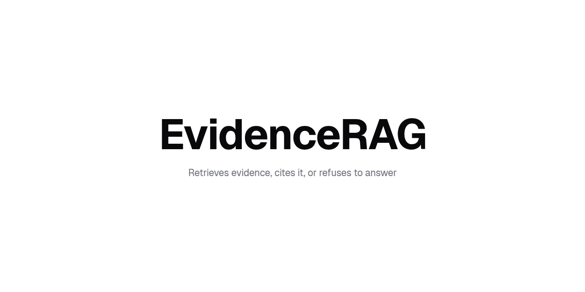

<p align="center">
  <picture>
    <source media="(prefers-color-scheme: dark)" srcset="docs/assets/social-preview.png" />
    
  </picture>
</p>

<p align="center"><b>A structure-aware RAG system that refuses to fabricate an answer when the evidence doesn't support one</b></p>

<p align="center">
  <a href="LICENSE"></a>
  &nbsp;
  <a href="https://fastapi.tiangolo.com/"></a>
  &nbsp;
  <a href="https://nextjs.org/"></a>
  &nbsp;
  <a href="https://evidence-rag.vercel.app"></a>
</p>

<p align="center"><sub><a href="#quick-start">Quick Start</a> · <a href="#how-it-works">How it works</a> · <a href="#docs">Docs</a> · <a href="#license">License</a></sub></p>

EvidenceRAG parses technical documents (Markdown, PDF, Word, Excel, CSV) into a hierarchical
structure instead of flat chunks, retrieves evidence with a hybrid BM25 + dense pipeline, cites
exactly which chunk an answer came from, and abstains instead of guessing when the evidence is
too weak.

**[Try the live demo →](https://evidence-rag.vercel.app)** — preloaded with a sample document
corpus, no setup required.

## Quick Start

A Supabase project is required regardless of storage mode — see
[`docs/QUICKSTART.md`](./docs/QUICKSTART.md) for the full setup (env vars, Supabase pooler
connection string, etc).

```bash
cd server && python -m venv .venv && source .venv/bin/activate
pip install -r requirements.txt && cp .env.example .env   # fill in VOYAGE_API_KEY, LLM_*, SUPABASE_URL
python scripts/ingest.py && uvicorn api.app:app --reload
```

```bash
cd web && pnpm install && cp .env.example .env            # fill in NEXT_PUBLIC_*
pnpm dev
```

## How it works

- **Documents become a tree, not a flat chunk list.** Every parser produces the same
  `KnowledgeNode` shape (headings, paragraphs, tables, figures, warnings, notes, code) — tables
  and figures stay atomic instead of getting chopped mid-row.
- **Retrieval is hybrid and reranked.** BM25 + dense similarity fused by Reciprocal Rank Fusion,
  then reranked, graded for relevance, and deduplicated — not a raw Top-K trusted blindly.
- **A matched chunk gets its context back.** Parent-section reconstruction re-expands a hit with
  its sibling nodes, instead of showing an excerpt stripped of the paragraph it came from.
- **It can say "I don't know."** Below a configurable retrieval-confidence threshold, the
  pipeline abstains and returns only the closest-match chunks — no synthesized claim.
- **The final answer is checked against its own sources.** A second LLM call scores whether the
  generated answer is actually supported by its cited chunks; below that threshold, the answer is
  withheld rather than returned as-is.
- **Every citation is real.** Numbered source citations point at an exact document, page/section,
  and snippet — not a vague "according to the documents" hand-wave.

Full design doc: [`docs/ARCHITECTURE.md`](./docs/ARCHITECTURE.md).

## Docs

| Doc | What's in it |
|:--|:--|
| [`docs/ARCHITECTURE.md`](./docs/ARCHITECTURE.md) | Pipeline stages, the swappable-storage/fixed-pipeline split, the LLM-call architecture, observability, tech stack, project structure, known limitations |
| [`docs/API.md`](./docs/API.md) | Every route's auth/rate-limit requirements and request/response shapes |
| [`docs/CONFIGURATION.md`](./docs/CONFIGURATION.md) | Every environment variable, what it does, and its default |
| [`docs/QUICKSTART.md`](./docs/QUICKSTART.md) | Full local setup for the server and web app |
| [`docs/EVALUATION.md`](./docs/EVALUATION.md) | Precision/Recall/MRR vs. a naive baseline, faithfulness scoring, and concrete system numbers |

## License

MIT — see [`LICENSE`](./LICENSE).
