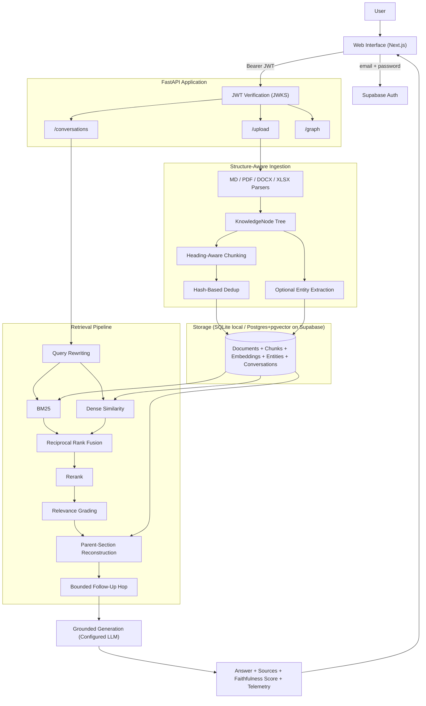

# Architecture

Two deployables: `server/` (FastAPI, Python) and `web/` (Next.js App Router). The frontend talks to
the backend only over HTTP — sign-in/sign-up go directly from the browser to Supabase Auth
(`web/lib/auth.ts`), never proxied through FastAPI. The backend's only auth role is verifying a
caller's JWT against Supabase's JWKS endpoint (`server/api/deps.py`) — no shared secret. Every route
requires a valid bearer token except `/health` and `/source/{filename}` (see `docs/API.md`).

## Document model is a tree, not flat chunks

Every parser (`server/src/ingestion/parsers/{markdown,pdf,docx,xlsx}.py`) converts its input into the
same `KnowledgeNode` tree shape (heading / paragraph / table / figure / warning / note / code nodes
with `heading_path` and `page_number`). This tree — not a flat text blob — is the source of truth:
`chunking.py`'s `chunk_nodes()` walks it to produce heading-boundary chunks while keeping tables/
figures atomic, and `compression.py`'s parent-section reconstruction later re-expands a matched chunk
with its sibling nodes from the same section. Any new parser or retrieval feature must preserve this
tree shape rather than working against raw chunk text.

## Query pipeline (`server/src/query_pipeline.py`)

`process_chat_query()` is the single entry point conversations call into, and it is doc-scoped (every
retrieval call is filtered to one conversation's `doc_ids`, not a global search). Flow: LLM query
rewriting (`retrieval/query_rewriter.py`) → hybrid retrieval — BM25 + dense + Reciprocal Rank Fusion
(`retrieval/hybrid.py`) → LLM-based reranking (`retrieval/reranker.py`, one batched call scoring every
candidate chunk's relevance 0.0–1.0, not a locally-hosted cross-encoder) → relevance grading + Jaccard
dedup (`retrieval/grader.py`) → context compression + parent-section reconstruction
(`retrieval/compression.py`) → an adaptive context budget (2/4/5 blocks based on top score) → a
**confidence gate**: below `RETRIEVAL_CONFIDENCE_THRESHOLD` the pipeline abstains instead of
generating, returning the closest chunks as `sources` with no synthesized claim → if confident but a
follow-up looks warranted, one bounded additional retrieval hop (never an open-ended loop) → grounded
generation (`generate_llm_chat()`/`generate_llm_chat_stream()`, `src/core/llm.py`) → faithfulness
scoring (`evaluation/judge.py`, a second cheap LLM call checking the answer against its own cited
chunks) → **faithfulness hard gate**: below `FAITHFULNESS_GATE_THRESHOLD` the generated answer is
withheld and replaced with an explicit "did not pass the faithfulness check" message (still listing
sources/unsupported claims) → telemetry (`telemetry.py`) logs every stage's latency.

The retrieval-confidence gate only runs in "advanced mode" — naive mode skips reranking entirely and
always attempts an answer. The faithfulness gate runs in both modes.

## LLM calls all go through one configurable endpoint

Every LLM call in this flow — query rewriting, reranking, judging, the final answer, and conversation
titling — runs on a configured OpenAI-compatible endpoint (`LLM_BASE_URL`/`LLM_API_KEY`/`LLM_MODEL`),
not a provider-specific SDK. This repo currently points that at Gemini's own OpenAI-compatible
endpoint (`generativelanguage.googleapis.com/v1beta/openai/`), but a self-hosted vLLM/Ollama instance,
OpenRouter, or any other OpenAI-compatible server works identically — it's the same
client/retry/cooldown/tracking code regardless of which endpoint `LLM_BASE_URL` points at.

`src/core/llm.py`'s `_llm_chat_completion()` is the one shared transport behind
`generate_llm_chat()`/`generate_llm_chat_stream()` (free text) and `generate_llm_json()`
(JSON-shaped output — reranking, judging, title generation, parsed defensively since not every
OpenAI-compatible endpoint reliably supports JSON mode). It carries a process-local cooldown that
activates on an HTTP 429 (honoring `Retry-After` when sent) and is *cleared, not retried* until it
expires — not a blind "retry every candidate" loop, which previously burned several minutes retrying
already-exhausted models on every call during a reingest. A transient non-429 failure gets a small
number of retries with exponential backoff + jitter instead. The client is lazily configured, so the
rest of the app (including every test) boots without `LLM_BASE_URL`/`LLM_API_KEY` set — only an
actual call raises.

Embeddings are independent of all of this: Voyage AI (`get_embedding()`/`get_embeddings_batch()`,
asymmetric `input_type="query"` vs `"document"`), retried against the same model (no fallback chain),
since `document_chunks.embedding` is a fixed-width pgvector column tied to one model's output
dimension. Swapping either provider doesn't require touching the other.

The Gemini-native SDK chain (`generate_chat_response()`/`generate_structured_response()`, walking
`GEMINI_CHAT_MODEL`/`GEMINI_FALLBACK_CHAT_MODEL`) still exists but is only called by `src/graph.py`'s
entity-graph extraction (disabled by default) and `scripts/test_connection.py`.

## Storage is swappable, pipeline logic is not

`STORAGE_MODE` (`local` vs `supabase`) only changes `server/src/storage/{database,files}.py` — SQLite
vs. Postgres+pgvector for the DB, local disk vs. Supabase Storage for raw files. Parsing, chunking,
reranking, and the entity graph run identically regardless of backend. `documents.user_id` is
nullable: `NULL` means a shared/demo document visible to every signed-in user (the
`docs/fixtures/sample_docs/` corpus); non-null means a private upload, scoped to that uploader.

One exception: `retrieval/hybrid.py`'s dense-retrieval layer differs by mode. In `local` mode it
computes cosine similarity against an in-memory, L2-normalized embedding matrix built from the
conversation's document scope. In `supabase` mode it calls `database.py`'s `dense_ann_search()`, a
real ANN query against `document_chunks.embedding` using an HNSW index built on
`(embedding::halfvec(N))` with `halfvec_cosine_ops` — every query against that index must apply the
identical `::halfvec(N)` cast on both sides of `<=>`, or the planner silently falls back to a full
sequential scan. Both the sparse (BM25) and dense indexes are scoped to the conversation's own
`doc_ids` (not the full corpus) and cached per scope (`_get_scoped_index()`, LRU-bounded), so per-query
latency/memory scales with a conversation's document set, not the total system-wide corpus. The
full-corpus cache still exists for `scripts/run_eval.py`'s eval search.

## Routers are thin; `api/services/` holds the logic; `api/authz.py` holds ownership checks

`api/routers/{documents,conversations,graph}.py` just parse the request and call into
`api/services/{document,conversation,graph}_service.py`. Each service method loads the resource,
asserts ownership, then acts — routers never touch `src/storage/database.py` or
`src/ingestion`/`src/query_pipeline` directly. Ownership checks live in `api/authz.py`
(`get_owned_document()`, `get_owned_conversation()`, `get_owned_graph_scope()`), not scattered per
router — every one of them 404s (not 403s) for a resource that doesn't exist or belongs to someone
else. See `docs/API.md` for the resulting route contracts.

## Observability

`src/core/logging_config.py` wraps stdlib `logging` with `structlog`, so every log line renders as
one JSON event (UTC timestamp, level, logger, event, plus structured fields). `src/core/ai_tracker.py`
wraps every real AI/embedding call site with one `ai.invocation.*` event per logical call (tagged with
an `operation` string — `"answer_generation"`, `"reranking"`, `"title_generation"`, etc.) plus a
separate `ai.http_attempt` event per actual outbound HTTP attempt, so "1 logical invocation → N HTTP
attempts" stays visible instead of collapsing into a single pass/fail line.
`src/core/request_summary.py` reduces one request's accumulated telemetry into exactly one
`chat.request.*` event, logged once per `process_chat_query()` call. `scripts/inspect_logs.py` reads
the resulting JSONL files directly (`logs/{application,ai,chat,errors}/*.jsonl`) to answer "how many
AI calls did this chat message make, and why" without hand-grepping. Every stage also runs inside
`src/core/observability.py`'s `traced_stage()`, under a per-request `request_id`.

## Other cross-cutting pieces

- **Guardrails** (`src/core/guardrails.py`): document chunks are untrusted content (any signed-in
  user can upload a document) embedded verbatim into the generation prompt.
  `scan_for_injection_patterns()` flags — never blocks/strips — chunks matching common
  prompt-injection heuristics into telemetry, and the generation prompt itself carries explicit
  instruction-hierarchy framing. A partial, iterative defense, not a one-shot fix.
- **Response cache** (`src/core/response_cache.py`): caches a fully-successful pipeline result (never
  a failure or an abstained/gated one) keyed by `(doc_ids, advanced_mode)`, matched by cosine
  similarity against the query embedding. Only consulted on a conversation's first turn — a follow-up
  depends on prior history, so caching it under the bare query embedding risks a stale/wrong-context
  answer.
- **Rate limiting** (`src/core/rate_limiter.py`): per-user sliding-window limits on the two routes
  that spend LLM/embedding quota (`POST /conversations/{id}/messages`, `POST /upload`) — see
  `docs/API.md` for the actual numbers.
- Both the response cache and the retrieval index cache are in-memory/per-process — not shared across
  workers or persisted across a restart.

## Entity graph is exploration-only

`server/src/graph.py` extracts per-section entities and builds co-occurrence edges (gated by
`ENABLE_ENTITY_GRAPH`, one LLM call per section). It powers `/graph` and the frontend's graph
visualization but is **not** consulted during retrieval or generation — despite the filename, it is
not an agentic orchestration graph.

## Frontend structure

`web/app/chat/[conversationId]/page.tsx` is one conversation's panel; `layout.tsx` above it is the
auth guard + sidebar shell for every `/chat/*` route. Session state is a single Zustand store
(`web/stores/auth-store.ts`) subscribed once at module load. `web/hooks/` (`use-auth`,
`use-conversations`, `use-documents`) wrap `lib/api.ts`'s authenticated fetch wrappers with
loading/error state so components don't duplicate fetch boilerplate.
